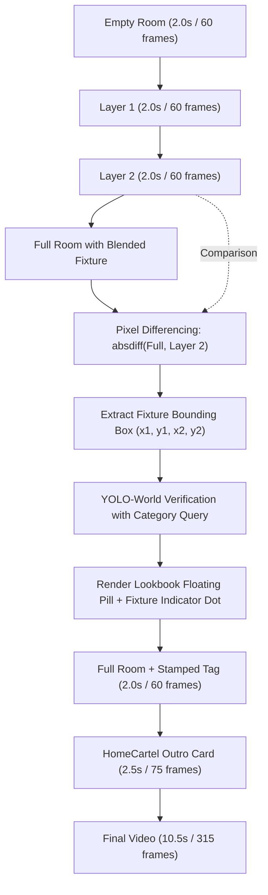

# Implementation Plan: One Part Per Room Reel 2.0s Timing & Precision Hybrid Item Tagging

> **Status**: Scheduled to be applied tomorrow (2026-10-27)  
> **Target Pipeline**: `C:\Users\User\Desktop\marketing-automation\generate_room_reveal_reel_pipeline.py` (Table: `tbldk5nac1UeYHd77`)  
> **UI Target**: `Marketing Output UI` (`One Part Per Room` Reel)  

---

## 🎯 Goal Description

Upgrade the **One Part Per Room Reel** (table `tbldk5nac1UeYHd77`) compilation pipeline to slow down photo transitions to a steady **2.0 seconds per photo** and stamp an ultra-accurate editorial product tag with a **lookbook dot indicator** directly pinpointing the fixture using **Hybrid Pixel Differencing + YOLO**.

1. **Transition Speed**: Upgrade from rapid cuts `(24, 20, 20, 36)` (0.67s–1.2s per photo) to a clean **2.0 seconds per photo** (`STATE_FRAMES = (60, 60, 60, 60)` at 30 FPS).
2. **Reel Duration**: 4 photos × 2.0s = 8.0s build-up + 2.5s HomeCartel outro = **10.5 seconds total runtime** (315 frames).
3. **100% Accurate Item Localization**: Because the camera angle is tripod-locked, computing the pixel difference between `Full` (with fixture) and `Layer 2` (without fixture) mathematically isolates the exact coordinate bounding box `(x1, y1, x2, y2)` where the fixture was blended in, completely eliminating false detections or misplaced tags.
4. **Editorial Tag with Indicator Dot**: Stamped on the `Full` photo beside the fixture, with a sleek indicator dot pointing to the fixture, displaying:
   - Line 1: Item Name in Poppins-Bold
   - Line 2: Product Type in Poppins-Regular
   - Luxury semi-transparent pill container with Instagram Reel safe-zone clamping.
5. **SFX Audio Sync**: Dynamically align pop effects at 2.0s, 4.0s, and 6.0s, with whoosh effects at 0.08s and 8.0s.
6. **Execution Scope**: Applies to new pipeline runs.

---

## 🏗️ Architecture & Data Flow



---

## 🛠️ Proposed Changes

### 1. Automation Pipeline (`C:\Users\User\Desktop\marketing-automation`)

#### [MODIFY] `generate_room_reveal_reel_pipeline.py`

1. **Update State Frame Counts & Timing**:
   ```python
   # 2.0 seconds per photo at 30 FPS = 60 frames each
   STATE_FRAMES = (60, 60, 60, 60)
   TOTAL_FRAMES = sum(STATE_FRAMES)  # 240 frames = 8.000 s of build-up
   TOTAL_SECONDS = TOTAL_FRAMES / VIDEO_FPS  # 8.0 s
   OUTRO_SECONDS = 2.5
   OUTRO_FRAMES = round(OUTRO_SECONDS * VIDEO_FPS)  # 75 frames
   FINAL_SECONDS = TOTAL_SECONDS + OUTRO_SECONDS  # 10.500 s
   ```

2. **Add Hybrid Fixture Localizer with Indicator Dot**:
   - Implement `locate_fixture_bbox_hybrid(full_img_path, layer2_img_path, category)`:
     - Loads both images, converts to grayscale, and calculates absolute pixel difference `absdiff`.
     - Applies morphological opening and thresholding to filter noise.
     - Extracts the largest bounding box corresponding to the added fixture.
     - Verifies with YOLO-World category query. If differencing yields low confidence, gracefully falls back to YOLO-World detection ladder.
   - Implement `stamp_lookbook_fixture_tag(...)`:
     - Renders floating pill with Poppins-Bold (Item Name) + Poppins-Regular (Product Type).
     - Renders an indicator dot on the fixture edge with a subtle hairline connecting to the tag pill.
     - Safe-zone clamps horizontally (< 900px to clear IG like/comment rail) and vertically (160px–1570px to clear header and caption).

3. **Phase 7 Video Assembly Integration**:
   - In `phase7_assemble(...)`, tag `images[STATE_FULL]` using `stamp_lookbook_fixture_tag(...)` to produce `tagged_full_path`.
   - Feed `tagged_full_path` into `reel_sequence(...)` and `final_sequence(...)`.
   - Audio tracks and SFX pop hits automatically align to 2.0s, 4.0s, 6.0s (reveal of tagged fixture), and whoosh at 8.0s (outro).

---

### 2. Marketing Output UI (`c:\Users\User\Downloads\Marketing Output UI`)

#### [MODIFY] `app/api/content-outputs/route.ts`
- Update duration metadata for One Part Per Room reels to reflect the 10.5s video runtime (`"11s"`):
  ```typescript
  const isOnePartPerRoom = isReels && (contentType.toLowerCase().includes("one part") || contentType.toLowerCase().includes("oppr"))
  duration: isReels ? (isOnePartPerRoom ? "11s" : "15s") : undefined,
  ```

---

## 🧪 Verification Plan

### Automated Tests
1. **Differencing & Tagging Tests**:
   - Unit test asserting that `locate_fixture_bbox_hybrid` accurately finds fixture coordinates from two sample frames.
   - Test verifying that `STATE_FRAMES = (60, 60, 60, 60)` produces frame cut points `[60, 120, 180]` and total runtime `10.5s`.
2. **Marketing Output UI Tests**:
   ```powershell
   npm test
   npm run typecheck
   npm run build
   ```
   Assert all 151 tests pass.

### Manual Verification
1. Run a new pipeline generation:
   ```powershell
   python run_room_reveal_reel.py --max-rows 1
   ```
2. Inspect the generated `Final Video`:
   - Verify that each of the 4 photos holds steadily for **2.0 seconds**.
   - Verify that the floating tag pill with the **indicator dot** points directly at the fixture during the final room reveal.
   - Verify that the video smoothly transitions to the HomeCartel outro at 8.0s with synced SFX sound.
